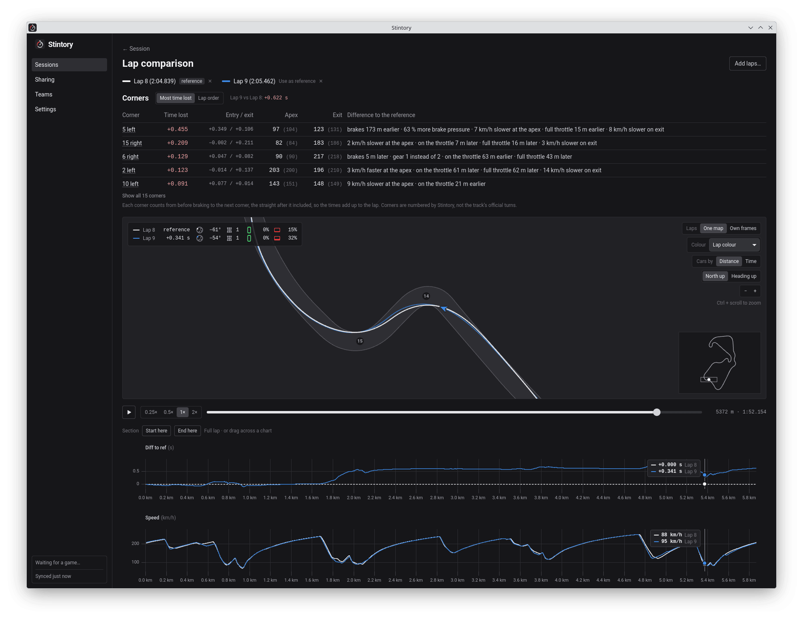
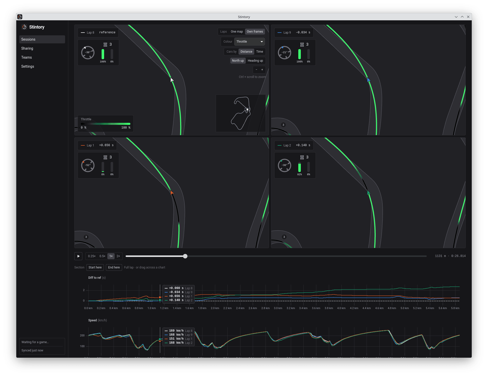

#  Stintory

[](https://github.com/AndiBern/Stintory/actions/workflows/ci.yml?query=branch%3Amain)

Record, review and compare your sim racing lap times. **Your data stays yours.** Everything is stored locally, with optional sync to a server you host yourself.

Most lap analysis tools send your telemetry to the vendor's servers so you can compare yourself with everyone else. Stintory sends nothing to any company: it stores your laps on your computer, and if you want to share them with friends or a team, you do that through your own server.



## Features

- **Automatic recording** of every session and lap while you drive, no clicks needed. Only your own car is recorded, never other drivers' data.
- **Session and lap browser**, lap view with traces over distance, and **lap comparison** with a time delta, a track map with a synced cursor and **corner insights**: where you lose time, corner by corner (braking point, minimum speed, throttle pick-up, exit speed).
- **Export and import** sessions and laps as `.stintory` files (and CSV), to move them to another computer or compare with laps from other people.
- **Self-hosted server** (Docker) with accounts (password, TOTP, passkeys) and a web UI. It syncs your sessions between your computers and lets you share sessions and laps with other users, teams, or everyone on the server. Compare your laps with the ones others share with you, in the browser or the desktop app.
- **AI assistants** (Claude and other MCP clients) can read your laps and the corner analysis to tell you where you lose time: from the desktop app on your computer (*Settings → AI*) or from your server ([docs/SERVER.md](docs/SERVER.md)). Stintory has no AI service of its own.



## Game support

| Game | Capture | Notes |
|---|---|---|
| iRacing | Windows; `.ibt` import everywhere | [docs/games/iracing.md](docs/games/iracing.md) |
| F1 25 (incl. 2026 Season Pack) | UDP: Windows, Linux (Proton), from PlayStation/Xbox or another PC | [docs/games/f1.md](docs/games/f1.md) |
| Le Mans Ultimate | Windows (shared memory; turn on *Enable Plugins* in the game); Linux (Proton) through the Proton bridge, or another shared-memory bridge (`/dev/shm`) | [docs/games/lmu.md](docs/games/lmu.md), [docs/games/proton.md](docs/games/proton.md) |

The desktop app runs on Windows and Linux. If those games support Linux recording should also work on Linux. Games that share telemetry via UDP (like F1) should work out of the box. Games that used shared memory require the help of `sy-bridge.exe`, a small helper that runs next to the game ([docs/games/proton.md](docs/games/proton.md)). More games may follow by demand. Game requests and discussion in [Supported Games and Platforms](https://github.com/AndiBern/Stintory/discussions/2)

## Installation

This installs the desktop app. To run your own server, see [docs/SERVER.md](docs/SERVER.md).

### Pre-built binaries

Download the file for your system from the [latest release](https://github.com/AndiBern/Stintory/releases/latest):

- **Windows:** `Stintory_<version>_x64-setup.exe`. Run it to install Stintory. The installer isn't signed, so Windows SmartScreen may warn you: click *More info → Run anyway*.
- **Linux:** `Stintory_<version>_x86_64.flatpak`. Install it with

  ```sh
  flatpak install --user Stintory_<version>_x86_64.flatpak
  ```

  If the runtime it needs is missing, Flatpak installs it from Flathub. Then start Stintory from your app menu or with `flatpak run de.stintory.Stintory`.

To update, install the file from the newer release the same way.

### Build from source

Install the requirements listed in [CONTRIBUTING.md](CONTRIBUTING.md#development-setup) (Rust, Node.js and, on Linux, the WebKitGTK packages). Then:

```sh
git clone https://github.com/AndiBern/Stintory.git
cd Stintory
npm ci
```

- **Windows:** `npm run build:desktop` builds the installer in `target/release/bundle/nsis/`.
- **Linux:** `npm run build:desktop:linux` builds the Flatpak in `target/flatpak/`. This also needs `flatpak-builder` and the MinGW-w64 cross compiler for `sy-bridge.exe` (see [docs/games/proton.md](docs/games/proton.md)). Install the result with `flatpak install --user` as shown above.

## Documentation

- Running a server: [docs/SERVER.md](docs/SERVER.md)
- Architecture, design rules and status: [docs/ARCHITECTURE.md](docs/ARCHITECTURE.md)
- Per-game behavior, verified against real recordings: [docs/games/](docs/games/)
- Game telemetry interfaces (incl. data not used yet), competitors and sources: [docs/RESEARCH.md](docs/RESEARCH.md)
- Building from source and contributing: [CONTRIBUTING.md](CONTRIBUTING.md)

## AI disclosure

Stintory is developed with the help of AI coding assistants, as is current state of the art in software development. Large parts of the code and documentation were written with them. Deciding what gets built, reviewing and testing the changes, and checking every game against real recordings before it counts as supported are done by me.

## License

- Apps (desktop client, server, web UI): [AGPL-3.0-or-later](LICENSE)
- Library crates (`sy-model`, game parsers `sy-source-*`): MIT OR Apache-2.0

See [docs/ARCHITECTURE.md §12](docs/ARCHITECTURE.md#12-licensing--clean-room-parsers) for details.
